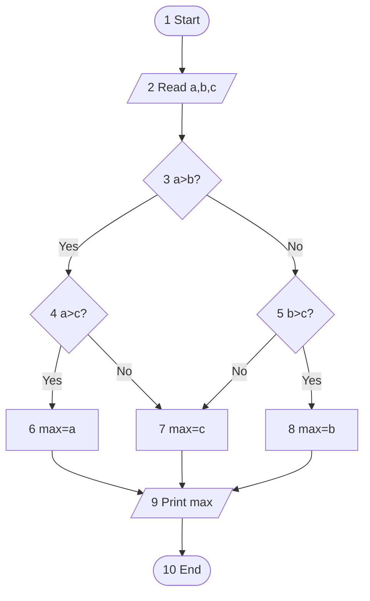

# Cyclomatic Complexity

Sample program: find the largest of three numbers.

| Quantity | Value |
|---|---|
| Nodes (N) | 10 |
| Edges (E) | 12 |
| Predicate nodes (P) | 3 |

- V(G) = E - N + 2 = 12 - 10 + 2 = **4**
- V(G) = P + 1 = 3 + 1 = **4**

Independent paths: 1-2-3-4-6-9-10, 1-2-3-4-7-9-10, 1-2-3-5-8-9-10, 1-2-3-5-7-9-10
